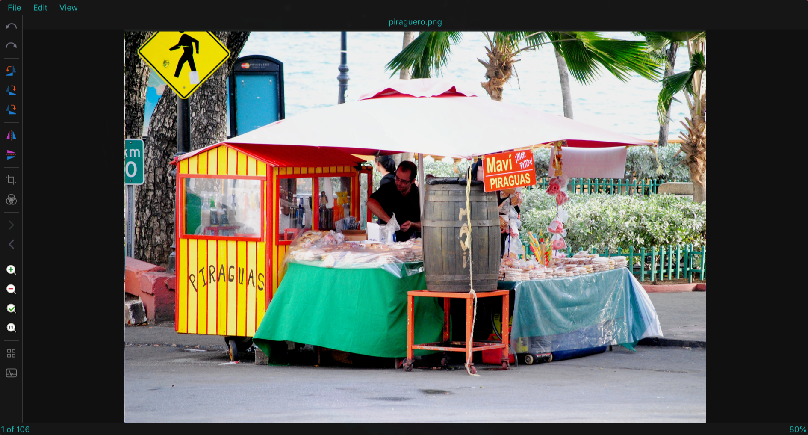

# Photollama

A fast, keyboard-driven image viewer for Linux, built with PySide6 (Qt6) and
designed to blend into an [Omarchy](https://omarchy.org) / Hyprland desktop by
reading the active theme's colors at runtime.

The inspiration for this app is Gwenview, but I wanted it to have the ability to rotate to any angle and reliable one-image-per-key navigation.

## Screenshot



## Features

- **Formats** — JPEG, PNG, GIF, WebP, TIFF, BMP, ICO, JPEG-2000, PDF and SVG
  (via Qt's image plugins and QtSvg). Animated GIF/WebP show the first frame.
- **Theming** — reads `~/.local/state/omarchy/current/theme/colors.toml` and
  applies the palette to the UI and the image canvas, hot-reloading when you
  switch themes.
- **Viewing** — zoom to cursor with the wheel, drag to pan, fit-to-window and
  actual-size, a grid of thirds (on by default, with a customizable color), and
  a toggleable RGB histogram.
- **Editing** — non-destructive: rotate 90°, rotate to any angle (with
  auto-crop), flip, crop with aspect-ratio presets, and a GIMP-style levels
  tool (input/output black, gamma and white points, per channel, with a live
  preview). Every change is undoable.
- **Lossless JPEG** — saves that only rotate/flip a JPEG are written with
  `jpegtran`, so no re-encoding.
- **File operations** — save, save as, move to trash, rename, open with, and a
  properties panel with EXIF metadata.
- **Browsing** — arrow-key navigation through a folder with a `N of M` counter
  (wrapping at the ends), drag & drop, and single-instance "Open with" handling.

## Requirements

- Python 3.11+
- `pyside6` and `python-numpy`
- `jpegtran` (from `libjpeg-turbo`) for lossless JPEG rotation — optional
- `gio` for moving files to the trash

Install dependencies via Omarchy menus. If installing on Arch:

```sh
sudo pacman -S pyside6 python-numpy libjpeg-turbo
```

## Install

Run the installer to create a launcher and register Photollama as a handler for
common image types:

```sh
./install.sh
```

This writes:

- `~/.local/bin/photollama` — a launcher that runs the app from this checkout
- `~/.local/share/applications/photollama.desktop`
- `~/.local/share/icons/hicolor/*/apps/photollama.png` (16–256 px)
- `xdg-mime` defaults for JPEG, PNG, GIF, WebP, TIFF, BMP, SVG, ICO and JP2

To uninstall, remove those files and reset the MIME defaults with your previous
viewer (for example `xdg-mime default org.kde.gwenview.desktop image/jpeg`).

## Usage

```sh
photollama              # open empty
photollama ~/Pictures   # open a folder
photollama photo.jpg    # open a single file
```

You can also run it from the checkout without installing:

```sh
python -m photollama ~/Pictures
```

## Keyboard shortcuts

| Action | Shortcut |
| --- | --- |
| Open file / folder | `Ctrl+O` / `Ctrl+Shift+O` |
| Save / Save as | `Ctrl+S` / `Ctrl+Shift+S` |
| Undo / Redo | `Ctrl+Z` / `Ctrl+Y` (also `Ctrl+Shift+Z`) |
| Next / Previous image | `Right` / `Left` (also `Space` / `Backspace`) |
| Zoom in / out | `Ctrl+=` / `Ctrl+-` |
| Fit to window / Actual size | `Ctrl+0` / `Ctrl+1` |
| Rotate left / right | `Ctrl+L` / `Ctrl+R` |
| Rotate to angle | `Ctrl+Shift+R` |
| Flip horizontal / vertical | `Ctrl+Shift+H` / `Ctrl+Shift+V` |
| Crop | `Ctrl+Shift+C` |
| Levels | `Ctrl+Shift+L` |
| AI Enhance | `Ctrl+Shift+A` |
| Grid of thirds | `G` |
| Histogram | `H` |
| Rename | `F2` |
| Delete (to trash) | `Del` |
| Properties | `Ctrl+I` |
| Quit | `Ctrl+Q` |

Navigation moves one image per key press and wraps around at the ends of the
folder; holding an arrow key does not skip ahead.

Choose **View > Grid Color…** to pick a color that stands out against the
current image. **View > Reset Grid Color** returns to the theme's default color.
The chosen color is remembered between sessions.

Mouse: the scroll wheel zooms toward the cursor, and dragging pans when zoomed
in. In the crop dialog, drag the handles to resize and the interior to move.
While the rotate dialog is open, drag the image in the main window to rotate it,
and press `Left`/`Right` to nudge the angle by 0.1° (`Shift` for 15°). The angle
field accepts 0.1° precision. The grid of thirds stays fixed, so it can be used
to judge when things are level.

## How it works

```
photollama/
  __main__.py       entry point, argument handling, single-instance socket
  window.py         main window: menus, status bars, actions, drag & drop
  canvas.py         QGraphicsView canvas: zoom, pan, thirds grid, histogram
  model.py          Document: original image + ordered edit ops (undo/redo)
  ops/              rotate90, rotate_angle, flip, crop, levels
  dialogs/          crop, levels, rotate and properties dialogs
  formats.py        loading, folder listing, SVG rendering
  imaging.py        numpy helpers: histograms and level LUTs
  exif.py           minimal pure-Python EXIF reader
  jpeg.py           lossless rotation/flip via jpegtran
  theme.py          Omarchy theme colors -> QPalette + stylesheet
```

Editing is non-destructive: the decoded original is kept untouched and edits are
stored as a list of operations. Rendering folds the operations over the
original; undo and redo simply move an index through that list.
